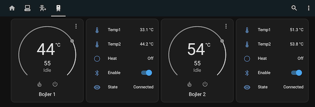

# ESPHome component for Dražice OKHE smart water heater

This ESPHome component connects to Dražice OKHE smart water heaters via Bluetooth Low Energy, collects data, and also allows for limited remote control.

You will need an ESP32 module and Home Assistant with the ESPHome integration. You also need to determine the MAC address of your water heater. See an [example configuration](example.yaml).

Note that only one device can be connected to the water heater at a time.

## Hardware

This component has been tested on:
* ESP32 dev board
* ESP32-C3

## Documentation

This ESPHome component uses standard ESPHome entities (sensors, switches, etc.), which are discovered automatically by Home Assistant through the native ESPHome API (`api:`).

### Entities

All entities are created automatically with the default names below. In Home Assistant they are shown under the ESPHome device, prefixed with its name (set `friendly_name` in the `esphome:` section, e.g. `Water heater` → `Water heater Upper temperature`).

| Default name | Config key | Type | Description |
| --- | --- | --- | --- |
| Thermostat | `thermostat` | climate | Target temperature for MANUAL/HDO mode (40–80 °C), current (upper) temperature and heating action |
| Mode | `mode` | select | Operating mode, see below |
| Lower temperature | `temp1` | sensor | Temperature detected by the lower temperature sensor |
| Upper temperature | `temp2` | sensor | Temperature detected by the upper temperature sensor (displayed on the water heater) |
| Heating | `heat_on` | binary sensor | On when the water heater is currently heating (consuming energy) |
| Energy | `consumption` | sensor | Energy consumed since the last reset (kWh) |
| Reset energy | `reset_energy` | button | Resets the energy counter in the water heater |
| Low tariff | `low_tariff` | binary sensor | On when the low (cheaper) tariff is available now, polled every 60 s |
| HDO decoder | `hdo` | switch | Enables/disables the internal HDO (ripple control) decoder |
| HDO | `hdo_low_tariff` | binary sensor | Same as the HDO decoder switch, kept for compatibility (disabled by default) |
| PROG temperature | `prog_temperature` | sensor | Target temperature currently used by the PROG (night) program |
| PROG low / high temperature | `prog_temp_low`, `prog_temp_high` | number | Temperatures used by the PROG program, 10–80 °C, low must be lower than high |
| Holiday starts in | `holiday_start` | number | Days until the holiday starts (0 = today) |
| Holiday length | `holiday_length` | number | Holiday length in days, `0` cancels the holiday |
| Anti-legionella | `antilegionella` | switch | Periodic anti-legionella heating (water heater FW 1.6 or newer) |
| Problem | `problem` | binary sensor | On when the water heater reports any error |
| Error | `error` | text sensor | `OK` or list of active errors (codes Er01–Er09 as in the original app) |
| Pairing PIN | `pin` | number | PIN for pairing, see below |
| State | `state` | text sensor | Connection state: Disconnected / Authenticating / Require PIN / Connected |
| Anode Voltage | `anode_voltage` | sensor | Voltage of the protective anode |
| Name | `b_name` | text sensor | Name of the water heater |
| Model | `model` | text sensor | Model of the water heater |
| Version | `version` | text sensor | Firmware version, board version and serial number |
| Capacity | `capacity` | sensor | Configured volume of the water heater (l) |

Any entity can be customized using its config key with standard ESPHome entity options:

```yaml
smartboiler:
  temp2:
    name: "Water temperature"   # rename
  model:
    internal: true              # don't expose to Home Assistant
  anode_voltage:
    disabled_by_default: true   # create in Home Assistant, but disabled
```

Switches and numbers show the state reported by the water heater. After a change, the value is re-read from the water heater, so a rejected change is reverted in Home Assistant.

To schedule a holiday, set *Holiday starts in* first and then *Holiday length* (setting the length sends both values to the water heater). The water heater switches to HOLIDAY mode for this period.

### Modes

This is the list of recognized mode values. See the [original app](https://play.google.com/store/apps/details?id=cz.dzd.smartbojler&hl=cs&gl=US) for more details, but the names are self-explanatory.

| Value      | Water heater mode           | Notes                                                    |
| ---------- | --------------------------- | -------------------------------------------------------- |
| MANUAL     | NORMAL (1) / HDO (2)        | HDO variant is used when the internal HDO decoder is on  |
| SMART      | SMART (3) / SMARTHDO (4)    | HDO variant is used when the internal HDO decoder is on  |
| ANTIFREEZE | ANTIFROST (5)               |                                                          |
| PROG       | NIGHT (6)                   | Program/schedule is configured in the original app       |
| STOP       | STOP (0)                    | Reported only, cannot be set                             |
| TEST       | TEST (7)                    | Reported only, cannot be set                             |
| HOLIDAY    | HOLIDAY (8)                 | Reported only, holiday is configured in the original app |

The thermostat entity shows `off` when the water heater is in STOP mode and `heat` otherwise. Its mode cannot be changed; use the mode select instead.


## Upgrading from older versions

* `smartboiler:` is no longer a list - remove the leading `- ` and fix the indentation.
* `ble_client_id` and `time_id` can be omitted when there is only one BLE client / time source.
* Entity names are now optional. To keep the existing pairing, **first flash the new version with your existing entity names** - the pairing UID is then migrated to a new storage key, which does not depend on entity names. After that you can remove the names. If you change the thermostat name before this migration, the water heater has to be paired again.

## Pairing process

The water heater requires the client to be "authenticated" in order to communicate. The client generates a random UUID, sends it to the water heater, and the water heater responds with a request for pairing and shows a PIN on the display.

This component allows you to set the pairing PIN and complete the pairing process from Home Assistant.

### 1. Configure ESP device

Create a configuration for ESP (see [example](example.yaml) for details). You need to know the water heater's Bluetooth MAC address (use any BT scanner to listen for BLE announcements. Please note that the water heater sends announcements only when no device is connected).

```yaml
esphome:
  name: water-heater
  friendly_name: Water heater

esp32:
  board: nodemcu-32s
  framework:
    type: esp-idf

external_components:
  - source:
      type: git
      url: https://github.com/pedobry/esphome-smartboiler
    components: [smartboiler]

logger:

# Enable Home Assistant API
api:
  encryption:
    key: !secret ha_API_key

ota:
  - platform: esphome
    password: !secret ota_password

wifi:
  ssid: !secret wifi_ssid
  password: !secret wifi_password

# Optional: used to keep the water heater clock in sync (used automatically when present)
time:
  - platform: homeassistant

ble_client:
  - mac_address: XX:XX:XX:XX:XX:XX
    id: water_heater

smartboiler:

switch:
  - platform: ble_client
    ble_client_id: water_heater
    name: "Monitoring"
```

I strongly recommend adding a switch to enable/disable the monitoring. The water heater allows only one device to connect at a time, and you might need to disconnect the monitoring when you want to use the mobile application for some complex settings or firmware upgrades.

### 2. Pairing with PIN

Once you flash the ESP32 and power it on, it will auto-generate a random UUID and try to connect to the water heater. Since it's not paired yet, it will end up in the `Require PIN` state (with the PIN visible on the water heater display). At this moment, you can enter the PIN in Home Assistant and it will finish the pairing process.

> **Important:**\
> The water heater keeps the PIN visible only for about 20 seconds, then it disconnects the client and the pairing process restarts. The water heater always generates a new PIN on each attempt. Wait for HA until it shows the state `Require PIN` and only then enter the PIN.\
\
Changing/setting the PIN in other states is ignored.\
Once the pairing is completed (state is `Connected`), the PIN value is also ignored.

The ESP32 stores the UUID in NVM and pairing is persistent between restarts.

### Setting time on water heater
The water heater has internal clock which measure date-less time (only day of the week and hours, minutes and seconds). This is used for scheduling of water heater stated or temperatures (available only in original app). For that, it's necessary that water heater has proper time set up. Unfortunately, the time is lost after power outage and needs to be set up again.

Add a `time:` source (for example `platform: homeassistant`). It is used automatically; if you have more than one time source, select it with `time_id`. The firmware then compares the heater clock to ESPHome and adjusts if it differs by more than 30 seconds, keeping the heater aligned with Home Assistant.

### How to reset UUID

ESPHome NVM can be reset by:

```bash
dd if=/dev/zero of=nvs_zero bs=1 count=20480
esptool.py --chip esp32 --port /dev/ttyUSB0 write_flash 0x009000 nvs_zero
```


